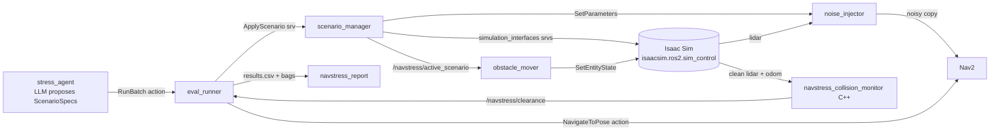

# Design

## What talks to what

- The LLM never commands the robot. Its only output is JSON that must pass
  `navstress_scenarios.schema` validation; motion goes through Nav2's
  `NavigateToPose` like any other goal.
- NavStress talks to the simulator only through `simulation_interfaces`, so the CI
  fake simulator (`navstress_fakesim`) can stand in for Isaac Sim.
- Noise is injected into what Nav2 sees; the collision monitor reads the clean
  sensor topics, so clearance is measured against the real world, not the degraded
  view being stress-tested.

## Costmap inputs: what the config says (read before any sim run)

SPEC §2.4 asks whether obstacles lower than what the costmap's sensors "see" are
invisible to the planner, and says to read the `carter_navigation` params first.
This section records what the config files and the Nav2 Jazzy source say. **It is a
prediction from reading config and source, not a measured result.** Phase 5 tests it
in simulation.

Sources: `IsaacSim-ros_workspaces` tag `IsaacSim-6.2.0`,
`jazzy_ws/src/navigation/carter_navigation/params/carter_navigation_params.yaml` and
`launch/carter_navigation.launch.xml`; Nav2 `jazzy` branch
`nav2_costmap_2d/plugins/{voxel_layer,obstacle_layer}.cpp`,
`nav2_voxel_grid/include/nav2_voxel_grid/voxel_grid.hpp`.

### Global costmap (planner)

- Layers: `static_layer`, `obstacle_layer`, `inflation_layer` (radius 1.0 m,
  cost_scaling_factor 0.3).
- `obstacle_layer` has one source: LaserScan on `/scan`, `max_obstacle_height: 2.0`.
- `/scan` is not a real sensor. `carter_navigation.launch.xml` runs
  `pointcloud_to_laserscan` on `/front_3d_lidar/lidar_points` with
  `target_frame: front_3d_lidar`, `min_height: -0.4`, `max_height: 1.5`, and
  `angle_min/max: ±1.5708` (front half only). Heights are relative to the lidar
  frame, so anything more than 0.4 m below the lidar is dropped before the planner
  sees it. How tall that makes the blind band depends on the lidar's mounting height,
  which the config does not state; Phase 4 reads it from TF.

### Local costmap (controller)

- Layers, in order: `front_3d_lidar_layer`, `front_2d_lidar_layer`,
  `back_2d_lidar_layer`, `inflation_layer`, `static_map_layer`.
- `front_3d_lidar_layer` is `nav2_costmap_2d::VoxelLayer` fed by PointCloud2
  `/front_3d_lidar/lidar_points` (source `hesai_mark`, marking only, source-level
  `min_obstacle_height: -0.4`, `max_obstacle_height: 1.5`) with layer-level
  `mark_threshold: 2`.
- In `voxel_grid.hpp`, `markVoxelInMap` marks a 2D cell only when the column's count
  of marked voxels is **greater than** `mark_threshold`. With `mark_threshold: 2` a
  column needs 3 marked voxels.
- The config does not set `z_resolution` or `z_voxels`, so the Nav2 defaults apply:
  `z_resolution: 0.2`, `z_voxels: 10`, `origin_z: 0.0`.
- Together: an obstacle only becomes lethal in this layer if its returns land in at
  least three 0.2 m bands, i.e. roughly 0.4 m or taller (assuming `odom` z = 0 at the
  floor). **Prediction:** shorter obstacles are not marked by the 3D lidar layer and
  must be caught by the 2D lidar layers, if at all.
- Several keys in that block are not parameters of `VoxelLayer` and are ignored:
  `voxel_size`, `voxel_decay`, `decay_model`, `filter`, `clear_after_reading`,
  `hesai_mark.obstacle_range`. They look like Spatio-Temporal Voxel Layer
  parameters. Because `obstacle_range` is not `obstacle_max_range`, the effective
  marking range is Nav2's default 2.5 m, not the 3.0 m the comment implies.
- The 2D layers read `/front_2d_lidar/scan` and `/back_2d_lidar/scan`. Whether the
  Nova Carter in the 6.2 warehouse scene publishes those topics, and at what mount
  height, is checked in Phase 4 (`ros2 topic list`, TF).
- `static_map_layer` comes after `inflation_layer`, so walls from the static map are
  not inflated in the local costmap. Noted, not yet known to matter.

### What would confirm or refute the prediction

Phase 5 sweeps obstacle height in front of the robot and records success,
collisions and clearance per height. If success collapses near 0.4 m (local layer)
or near the `pointcloud_to_laserscan` cut-off (global layer), the prediction holds.
If not, this section gets corrected with the measured boundary.
